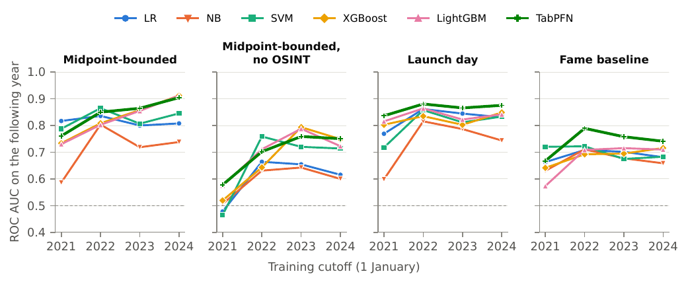

# LROO: time-consistent rug-pull classification from on-chain and OSINT signals

This repository contains the code, data and results behind the paper
*LROO: Time-Consistent Rug-Pull Classification from On-Chain and OSINT
Signals* (Fatemeh Shoaei, Mohammad Pishdar, Mozafar Bag-Mohammadi, Mojtaba
Karami and Bert Lagaisse). Fatemeh Shoaei and Mohammad Pishdar contributed
equally and are joint first authors. Corresponding author: Mohammad Pishdar
(mohammad.pishdar@kuleuven.be).

LROO asks a forensic question: once a token has stopped trading, how likely is
it that the collapse was a rug pull rather than an honest failure, a contract
migration or a temporary glitch? It answers with a classifier trained on
on-chain behavior and on web attention to the project, evaluated under a
protocol that only lets the model see what would have been known at the time.

## Main results

All numbers are ROC AUC on the 191 most recently launched projects (142 rug
pulls, 49 legitimate). Training is restricted to projects whose features and
labels were known on the cutoff date (15 September 2023). Brackets give
bootstrap 95% intervals.

| Feature set | Real-TabPFN | XGBoost | LightGBM | SVM | Logistic regression |
|---|---|---|---|---|---|
| Launch day only | 0.835 [0.766, 0.900] | 0.814 | 0.802 | 0.799 | 0.789 |
| **Up to the midpoint (main)** | **0.888 [0.836, 0.933]** | 0.872 | 0.869 | 0.825 | 0.766 |
| Including end-of-project features* | 0.965 | 0.904 | 0.926 | 0.937 | 0.917 |

\* Not estimable under time-consistent training: no legitimate project is
admissible, because its end-of-project features only become observable at data
collection. Shown with unrestricted training as an upper reference.

- Web-search attention to the project's X account is the strongest signal.
  Removing all OSINT features costs between 0.11 and 0.16 AUC for every model
  (Real-TabPFN drops to 0.741).
- Real-TabPFN is ahead of XGBoost and LightGBM but not significantly
  (DeLong, Holm-adjusted p = 0.478 for both). Its probabilities are the best
  calibrated (Brier 0.133).
- End-of-project on-chain features look excellent, but the end date itself
  separates the test classes perfectly (AUC 1.000). Read these features as an
  upper bound, not as a result. See [docs/leakage.md](docs/leakage.md).
- A rolling-origin evaluation over four yearly cutoffs (2021 to 2024) gives
  mean AUCs between 0.815 and 0.845 on the main feature set for every model
  except naive Bayes, and 0.865 for Real-TabPFN on the launch-day set.
- Removing the 28 rows flagged by the on-chain audit changes no AUC by more
  than 0.025.

### Reproducible feature sets

Google result counts cannot be measured again. We therefore also evaluate
feature sets that anyone can recompute (Real-TabPFN, time-consistent
training):

| Feature set | AUC |
|---|---|
| Internet Archive captures, launch day | 0.779 |
| Internet Archive captures, midpoint | 0.799 |
| Google counts + archive captures, launch day | 0.866 |
| On-chain statistics 30 days after the first transfer only | 0.729 |
| Archive captures + day-30 on-chain statistics | 0.761 |

The day-30 sets use only projects that lasted at least 30 days after their
first transfer, so no collapse falls inside the observation window. On the
launch-day set, adding the archive counts to the Google counts improves the
AUC significantly (DeLong p = 0.027). On 62 small legitimate projects that
were never seen in training, each reviewed by two people, the day-30 model
flags 3 of the 24 clean projects it can score. That is a rate no higher than
its 18% false-alarm rate on the legitimate test projects.



## Repository layout

```
data/       TM-RugPull v2 (Excel workbook with data, protocol, column dictionary, review list and change log)
src/        lroo_pipeline.py, the complete experiment pipeline
scripts/    TabPFN runner, leakage audit, on-chain and archive collection, reproducible variants, paper assets
notebooks/  Google Colab notebook that runs everything end to end
results/    every result table, prediction file and run log used in the paper
figures/    the paper figures as PNG
paper/      LaTeX source of the paper (figures as PDF, generated tables and numbers)
docs/       datasheet, leakage notes, reproducibility guide
```

## Quick start

```bash
pip install -r requirements.txt

# Everything except TabPFN
python src/lroo_pipeline.py data/TM-RugPull_v2.xlsx results_local

# With Real-TabPFN (the key is read from the environment, never from a file)
export TABPFN_TOKEN=...
python scripts/run_with_tabpfn.py data/TM-RugPull_v2.xlsx results

# Leakage audit and reproducible feature sets
python scripts/leakage_audit.py data/TM-RugPull_v2.xlsx results
python scripts/eval_variants.py data/TM-RugPull_v2.xlsx results/onchain_source.csv results

# Every table, figure and number in the paper
python scripts/make_paper_assets.py data/TM-RugPull_v2.xlsx results paper
python scripts/make_audit_assets.py data/TM-RugPull_v2.xlsx results paper
cd paper && latexmk -pdf main.tex
```

[docs/reproducibility.md](docs/reproducibility.md) gives package versions,
run times and notes on determinism.

## The dataset in one paragraph

TM-RugPull v2 has 1059 rows. 954 token projects are used in the experiments
(565 rug pulls, 389 legitimate) on eight EVM chains, mostly Ethereum (591) and
BNB Smart Chain (318). A project counts as a rug pull when three conditions
hold together for at least 72 hours: liquidity near zero, no meaningful
on-chain activity and a price that can no longer be determined. Each label is
confirmed against incident databases and by two experts. For this release
every label was audited on chain and against incident reports, and 95% of the
contracts were confirmed from their own transfer history. No row was deleted:
43 rows are kept but excluded, with the reason in the file. Another 62 small
legitimate projects, reviewed by two people, serve as an external false-alarm
check. Every feature is tagged with the time at which it becomes observable.
See [data/README.md](data/README.md) and [docs/DATASHEET.md](docs/DATASHEET.md).

## What this work does not claim

LROO is not an early-warning system. Its main feature set is defined relative
to the midpoint of a project's lifetime, which is known only after the project
has ended. Turning the launch-day results into evidence for early warning
would require features collected prospectively, at launch.

## Citation


## License

The code is released under the MIT License (see [LICENSE](LICENSE)).
